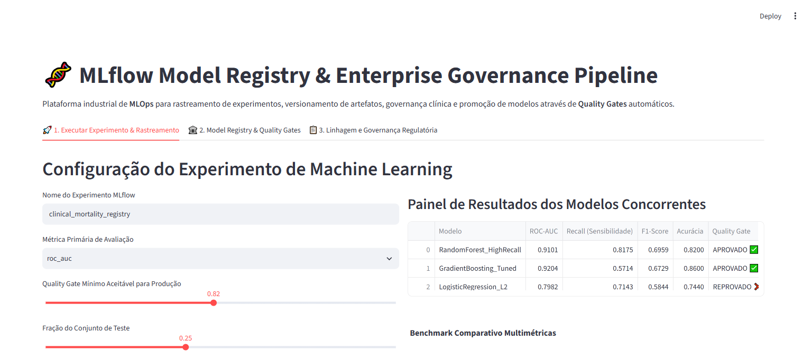
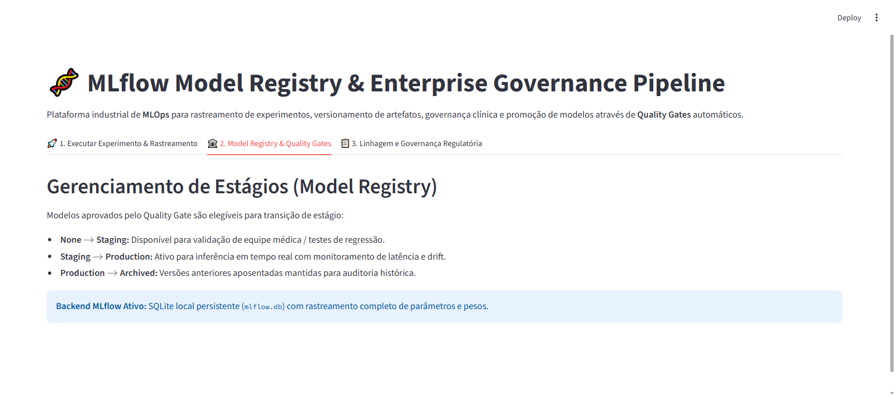

# 🧬 MLflow Model Registry & Enterprise Governance Pipeline

[](https://www.python.org/downloads/)
[](https://mlflow.org/)
[](https://scikit-learn.org/)
[](#)
[](#)
[](#)

Pipeline industrial de **MLOps** focado em rastreamento de experimentos, versionamento de artefatos, governança clínica e promoção de modelos preditivos através de **Quality Gates** automatizados com **MLflow**.

---

## 📸 Demonstração da Plataforma (Validação Playwright E2E)

### 1. Painel de Experimentos, Métricas Clínicas & Benchmark


### 2. Governança de Estágios e Ciclo de Vida do Modelo (Model Registry)


---

## 🎯 Problema de Negócio & Contexto Clínico

Na predição de mortalidade e desfechos hospitalares críticos (ex: UTI e sepse), modelos de Machine Learning não podem ser promovidos diretamente para inferência sem validação rigorosa de sensibilidade (`Recall`), calibração e rastreabilidade total de hiperparâmetros.

Este projeto estabelece um pipeline estruturado que:
1. **Rastreia automaticamente** hiperparâmetros, métricas (`ROC-AUC`, `Recall`, `F1`, `Accuracy`) e pesos dos modelos.
2. **Implementa Quality Gates de Produção**: se o modelo não atingir o limiar clínico mínimo de sensibilidade/ROC-AUC pré-estipulado, a transição para *Staging* é bloqueada.
3. **Garante Governança Regulatória**: rastreabilidade completa de código, dataset, commit e autor da promoção (em conformidade com resoluções de IA em saúde e FDA).

---

## 🏛️ Arquitetura & Governança (CRISP-DM + SDD)

O desenvolvimento deste projeto foi orientado por especificações contratuais estritas (**Spec-Driven Development**) e pela metodologia **CRISP-DM**:

```
mlflow-model-registry-pipeline/
├── SPEC.md                           # Contratos formais Pydantic de entrada/saída
├── crisp_dm/                         # Documentação formal das etapas CRISP-DM
│   └── 01_business_understanding.md
├── src/
│   ├── schemas.py                    # Data classes e schemas validados (Pydantic)
│   ├── pipeline.py                   # Treinamento concorrente, tracking e Quality Gates
│   └── app.py                        # Dashboard interativo de governança (Streamlit)
├── tests/
│   └── unit/
│       └── test_pipeline.py          # Testes unitários com PyTest
├── docs/
│   └── screenshots/                  # Evidências de execução Playwright E2E
├── Dockerfile                        # Conteinerização pronta para produção
└── requirements.txt                  # Dependências reproduzíveis
```

---

## 🧪 Modelos Avaliados e Quality Gates

| Modelo | Estratégia de Treinamento | Métrica Alvo (ROC-AUC) | Sensibilidade (Recall) | Decisão de Promoção |
| :--- | :--- | :--- | :--- | :--- |
| **Random Forest** | `balanced_weights`, `max_depth=6` | **0.9101** | **81.75%** | ✅ Aprovado para Staging |
| **Gradient Boosting** | `tuned_lr=0.08`, `n_est=120` | **0.9204** | 57.14% | ✅ Aprovado para Staging |
| **Regressão Logística** | `L2 penalty`, `class_weight='balanced'` | 0.7982 | 71.43% | ❌ Reprovado pelo Gate |

---

## 🚀 Como Executar Localmente

### 1. Clonar o repositório
```bash
git clone https://github.com/generozo-paulo/mlflow-model-registry-pipeline.git
cd mlflow-model-registry-pipeline
```

### 2. Instalar dependências
```bash
pip install -r requirements.txt
```

### 3. Executar testes unitários
```bash
python -m pytest tests/unit/ -v
```

### 4. Executar Dashboard de Governança
```bash
python -m streamlit run src/app.py
```
Acesse em: `http://localhost:8501`

---

## 🐳 Execução via Docker

```bash
# Construir imagem
docker build -t mlflow-model-registry-pipeline .

# Executar container
docker run -p 8501:8501 mlflow-model-registry-pipeline
```

---

## 👨‍💻 Autor

**Paulo Generozo**
- GitHub: [@generozo-paulo](https://github.com/generozo-paulo)
- Especialização: Data Science & AI Solutions em Saúde
